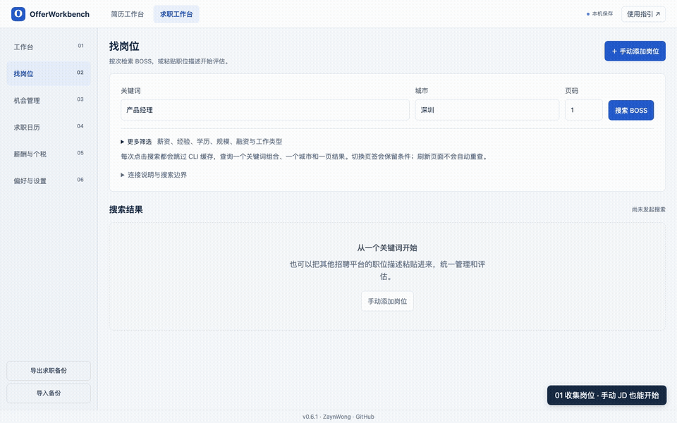

# OfferWorkbench

**从一个岗位，到一份定向简历，再到每一次跟进。**

一个本地优先的求职工作台。把散落在招聘网站、Word、备忘录和表格里的准备工作，收进同一套流程；你负责判断与实际提交，工作台负责保存材料、排版与追踪。

[开始使用](#开始使用) · [完整指南](docs/USER_GUIDE.md) · [下载版本](https://github.com/zaynwong981/offer-workbench/releases) · [开发路线](PROJECT.md)

## 一次求职任务，怎样走完



[观看完整操作视频 MP4](https://github.com/zaynwong981/offer-workbench/blob/main/docs/media/workflow-demo.mp4) · [试用同一套合成案例](docs/DEMO.md)

演示录制自真实运行界面，资料全部虚构。招聘平台上的登录、联系和投递仍由本人完成，视频不模拟投递成功。

```text
收集岗位 → 查看匹配依据 → 复用或定制简历 → 预览并导出 PDF
                                              ↓
                比较薪酬 ← 安排笔试／面试 ← 本人提交后记录进度
```

| 任务 | 在工作台完成什么 |
|---|---|
| 找到值得投入的机会 | 粘贴 JD 和链接，或按需连接 BOSS 搜索；用分栏查看岗位、保存筛选方案，记下看过与取舍原因 |
| 为公司准备一份简历 | 共用个人资料与照片，维护多个方向，复制岗位专属版本并手动微调 |
| 摆脱反复排版 | 直接预览真实 PDF、检查页数、裁剪照片，一键导出并保留历史文件 |
| 记住实际进展 | 关联岗位与简历，集中准备沟通文字和作品；本人确认后留存当时的PDF、渠道与时间 |
| 安排笔试与面试 | 月历看完整安排，多事件记录具体时间、DDL 和冲突，导出 ICS |
| 判断待遇是否值得 | 北京／上海／广州／深圳／杭州薪酬估算，比较全年税后到手和社保公积金扣款 |

### v0.7.1 改善了什么

求职偏好支持不限、校招、社招和实习。常用城市之外，可填写中国大陆城市或香港；岗位与业务用两级分类加入，也能直接修改匹配词。薪资可选区间或手填金额，在「找岗位」点击「从已保存偏好填写」即可复用，每次核对后再发起一次搜索。

机会列表更窄、详情更宽，减少卡片上的重复提示。岗位准备、实际提交留档、五城薪酬、日历和简历排版继续保留。校招／社招使用普通搜索的经验条件，实习使用岗位类型，不代表校招专区或报名资格校验；参数依据与限制见 [筛选说明](docs/reference/BOSS_FILTER_SOURCES.md)。

[查看用户旅程与原始流程对照](docs/design/USER_JOURNEY.md) · [查看政策来源与限制](docs/reference/SALARY_POLICY_SOURCES.md)

上述 GIF／MP4 使用 v0.7.0 合成资料演示完整流程；其中的提交确认是演示记录，没有向任何招聘方提交。

## 开始使用

需要 Python 3.11+ 和本机中文 TrueType 字体。无需 Node、构建工具、账号注册或模型 API Key。BOSS CLI 是可选依赖，未连接也能完成手动岗位与简历流程。

下载 [Release 源码包](https://github.com/zaynwong981/offer-workbench/releases/latest) 解压，或克隆：

```sh
git clone https://github.com/zaynwong981/offer-workbench.git
cd offer-workbench
python3 -m venv .venv
.venv/bin/python -m pip install -r requirements.txt
.venv/bin/python server.py --open
```

Windows 使用 `python -m venv .venv` 和 `.venv\Scripts\python -m pip install -r requirements.txt`，然后双击 `start.bat`。macOS 可在安装依赖后双击 `打开简历工作台.command`。Linux 安装中文字体，例如 `fonts-wqy-zenhei`。自定义字体见 [使用文档](docs/USER_GUIDE.md)。

浏览器打开 `http://127.0.0.1:8766/career`。顶部进入「简历工作台」或「求职工作台」，右上角「使用指引」介绍完整操作。

## 资料与使用边界

- **默认本机保存，无遥测。** `data/` 保存简历、照片、岗位、日程与历史PDF留档；`exports/` 保存 PDF，可用本地配置改路径。它们不进入 Git 和发布包。
- **提交由你确认。** 不自动发消息、上传附件、代投、处理登录或验证码；导出 PDF 不代表投递成功。
- **事实保持可核验。** 当前匹配是可解释的词项证据，不是录用预测；尚未接入 LLM 改写，不编造履历。
- **外部连接可选。** BOSS 接入依赖社区 CLI，平台变化会影响可用性；遇风险停止，不自动重试。分页和部分薪资完整性仍待在线验收。
- **日历是本地安排。** 使用北京时间；ICS 为手动导入快照，无后台提醒或双向同步。薪酬是固定参数估算，实际以单位和税务申报为准。
- **面向单机个人使用。** 服务仅监听回环地址，不应直接暴露公网。无需把个人备份上传 GitHub。

## 开发与持续迭代

[PROJECT.md](PROJECT.md) 是唯一需求、决策与交接入口，含四阶段路线和跨对话／工具迁移提示。新贡献先读 [AGENTS.md](AGENTS.md) 和 [CONTRIBUTING.md](CONTRIBUTING.md)。

```text
app/
  backend/          本机 HTTP、简历 PDF、岗位与日程、BOSS 适配器
  frontend/         HTML 页面，js/、css/、config/ 与 vendor/
docs/               使用指南、架构、验收、演示与发布回滚
scripts/            合成演示、源码打包、隐私检查、备份恢复
tests/              匿名后端与前端回归
server.py           保持兼容的启动入口
PROJECT.md          需求、决策和迁移入口
```

运行 `python -m unittest discover -s tests -v`、`node tests/test_editor_state.js` 和 `node --test tests/test_*.js`。公开提交只使用源码白名单，并执行 `python scripts/privacy_check.py`。GitHub CI 覆盖 macOS／Windows／Ubuntu。

版本标签触发校验与源码发布。升级先备份，回滚恢复到新目录验证，详见 [发布与回滚](docs/RELEASING.md)。历史版本不覆盖，个人数据不随代码回退。

## 项目与贡献

由 [ZaynWong](https://github.com/zaynwong981) 开发维护，欢迎通过 [Issues](https://github.com/zaynwong981/offer-workbench/issues) 提交去除个人资料的复现步骤与使用反馈。

自有代码采用 [MIT](LICENSE)；PDF.js、依赖及字体边界见 [第三方说明](THIRD_PARTY_NOTICES.md)。
