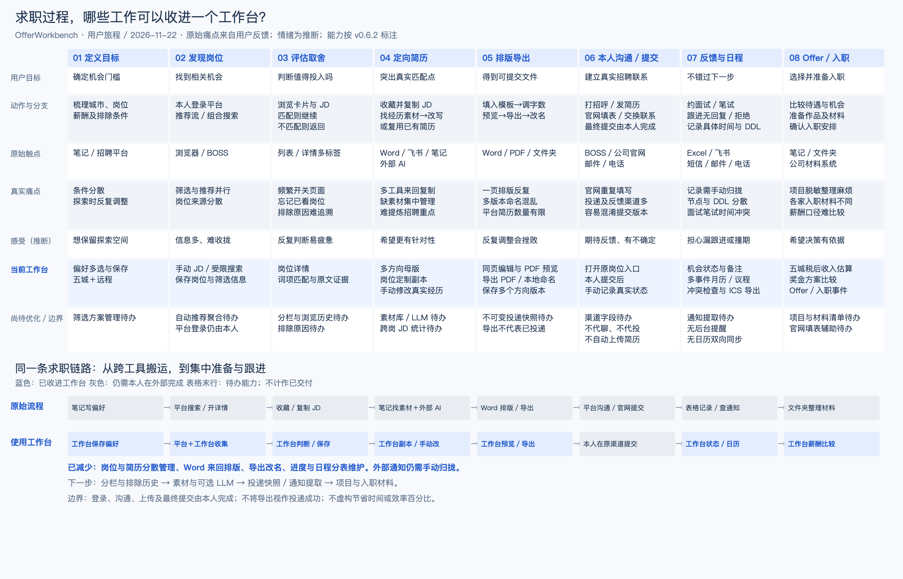

# 用户旅程与流程对照

版本：v0.6.2；整理日期：2026-11-22。图中痛点来自用户提供的旅程，感受为推断；公开内容不含个人资料或私有文档链接。

[可编辑 SVG](../images/user-journey.svg)

| 维度 | 定义目标 | 发现岗位 | 评估取舍 | 定向简历 | 排版导出 | 本人沟通／提交 | 反馈与日程 | Offer／入职 |
|---|---|---|---|---|---|---|---|---|
| 用户目标 | 确定机会门槛 | 找到相关机会 | 判断值得投入吗 | 突出真实匹配点 | 得到可提交文件 | 建立真实招聘联系 | 不错过下一步 | 选择并准备入职 |
| 动作与分支 | 梳理城市、岗位；薪酬及排除条件 | 本人登录平台；推荐流／组合搜索 | 浏览卡片与 JD；匹配则继续；不匹配则返回 | 收藏并复制 JD；找经历素材→改写；或复用已有简历 | 填入模板→调字数；预览→导出→改名 | 打招呼／发简历；官网填表／交换联系；最终提交由本人完成 | 约面试／笔试；跟进无回复／拒绝；记录具体时间与 DDL | 比较待遇与机会；准备作品及材料；确认入职安排 |
| 原始触点 | 笔记／招聘平台 | 浏览器／BOSS | 列表／详情多标签 | Word／飞书／笔记；外部 AI | Word／PDF／文件夹 | BOSS／公司官网；邮件／电话 | Excel／飞书；短信／邮件／电话 | 笔记／文件夹；公司材料系统 |
| 真实痛点 | 条件分散；探索时反复调整 | 筛选与推荐并行；岗位来源分散 | 频繁开关页面；忘记已看岗位；排除原因难追溯 | 多工具来回复制；缺素材集中管理；难提炼招聘重点 | 一页排版反复；多版本命名混乱；平台简历数量有限 | 官网重复填写；投递及反馈渠道多；容易混淆提交版本 | 记录需手动归拢；节点与 DDL 分散；面试笔试时间冲突 | 项目脱敏整理麻烦；各家入职材料不同；薪酬口径难比较 |
| 感受（推断） | 想保留探索空间 | 信息多、难收拢 | 反复判断易疲惫 | 希望更有针对性 | 反复调整会挫败 | 期待反馈、有不确定 | 担心漏跟进或撞期 | 希望决策有依据 |
| 当前工作台 | 偏好多选与保存；五城＋远程 | 手动 JD／受限搜索；保存岗位与筛选信息 | 岗位详情；词项匹配与原文证据 | 多方向母版；岗位定制副本；手动修改真实经历 | 同页编辑与 PDF 预览；导出 PDF／本地命名；保存多个方向版本 | 打开原岗位入口；本人提交后；手动记录真实状态 | 机会状态与备注；多事件月历／议程；冲突检查与 ICS 导出 | 五城税后收入估算；奖金方案比较；Offer／入职事件 |
| 尚待优化／边界 | 筛选方案管理待办 | 自动推荐聚合待办；平台登录仍由本人 | 分栏与浏览历史待办；排除原因待办 | 素材库／LLM 待办；跨岗 JD 统计待办 | 不可变投递快照待办；导出不代表已投递 | 渠道字段待办；不代聊、不代投；不自动上传简历 | 通知提取待办；无后台提醒；无日历双向同步 | 项目与材料清单待办；官网填表辅助待办 |

## 上下流程对照

原始：笔记写偏好 → 平台搜索／开详情 → 收藏／复制 JD → 笔记找素材＋外部 AI → Word 排版／导出 → 平台沟通／官网提交 → 表格记录／查通知 → 文件夹整理材料

工作台：工作台保存偏好 → 平台＋工作台收集 → 工作台判断／保存 → 工作台副本／手动改 → 工作台预览／导出 → 本人在原渠道提交 → 工作台状态／日历 → 工作台薪酬比较

已收拢的是岗位保存、定向简历副本、PDF 排版预览与导出、手工进度记录、日程冲突检查和薪酬比较。平台沟通、官网填写、通知归拢仍需本人操作。素材库、LLM、跨岗 JD 统计、不可变投递快照、渠道字段、项目材料清单仍是待办，不能计为已减少的工作量。

本图不声称节省固定时间或提高固定百分比。后续可记录完成同一任务的工具切换次数、重复输入次数与实际耗时，再做验证。具体需求状态见 [PROJECT.md](../../PROJECT.md)。
